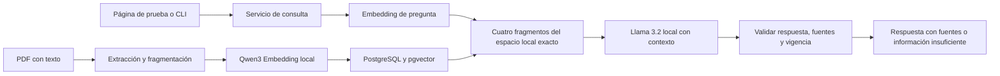

# Sprint 1 — prototipo funcional del RAG con Ollama

El cronograma del PDF (página 9) asigna semanas 7–8 a definición y preparación y pide un
«Prototipo funcional del RAG». El alcance inicial de ingesta se amplió explícitamente para cerrar
ese entregable con preguntas, recuperación básica, respuestas con fuentes y una página de prueba.
Se utiliza exclusivamente Ollama. La integración con Moodle permanece en Sprint 2.

## Flujo y decisiones

- `qwen3-embedding:0.6b` genera embeddings de 1024 dimensiones; `qwen2.5:3b` genera respuestas.
- La búsqueda solo compara el mismo proveedor, modelo, digest y dimensión, con cobertura completa.
- La consulta Qwen lleva su instrucción de recuperación; los documentos se indexan sin esa instrucción.
- La respuesta estructurada debe citar fragmentos suministrados. Los títulos, páginas y texto de las
  fuentes se obtienen de la base. Si el corpus cambió durante la consulta, se rechaza la respuesta.
- La página muestra material ficticio y usa texto seguro; no añade cuentas ni historial persistente.
- El repositorio es independiente de `moodle/`. No se modifica Moodle ni se publican recursos en AWS.

Las interfaces añadidas son `POST /api/v1/chat/query`, `GET /demo`, `rag ask`, `rag prepare-chat` y
`rag prepare-demo`. La ingesta, listado, eliminación, preparación de índice y salud siguen disponibles.
No se añadió otra migración: se reutiliza el esquema versión 2.

El endpoint de Moodle requiere una aserción firmada servidor a servidor. La página de demostración
usa una ruta separada que solo se habilita con `LOCAL_DEMO_QUERY_ENABLED` en el Compose local.

## Trazabilidad del incremento

| Requisito / historia | Evidencia del prototipo |
|---|---|
| RF-04 / RF-05 / HU-03 | Administración de documentos, embeddings locales y actualización/borrado consistentes |
| Recuperación y contexto / HU-02 | Búsqueda vectorial básica y respuesta con fragmentos recuperados |
| Fuentes e información insuficiente / HU-02 | Referencias validadas, páginas y abstención explícita |
| Consulta mediante API / HU-01 | Endpoint local y página de prueba; aún sin chat Moodle |
| RNF-09 / HU-07 | Servicio separado, Docker, Git y documentación reproducible |
| RNF-10 / HU-05 | Eventos con duración y códigos, sin contenido sensible |
| RNF-11 | Errores controlados, rollback y rechazo de fuentes que dejaron de estar vigentes |
| RNF-12 / HU-07 | Pruebas de unidad, PostgreSQL, API, navegador y evaluación real |

Estas historias solo se acreditan para el prototipo local. Autenticación, acceso de usuarios Moodle,
recuperación avanzada, calidad sobre corpus oficial y requisitos generales de carga siguen pendientes.

## Corpus y aceptación

Tres documentos ficticios de la Universidad Demo del Valle cubren matrícula, reglamento y trámites.
Tienen tres páginas cada uno, claves estables y textos originales versionados. Los PDF se generan de
forma reproducible. No se presentan como documentos oficiales ni sustituyen el corpus real futuro.

El cierre exige suite estricta sin omisiones, Ruff, página funcional en Docker y evaluación fija de
20 preguntas positivas y 5 negativas. Se requiere al menos 80 % de positivas correctas y abstención
en todas las negativas; las fuentes deben pertenecer a los fragmentos recuperados vigentes.
La evidencia y las limitaciones de latencia se registran en [validación](validation.md).

El prototipo local cumple estos criterios: 127 pruebas automáticas aprobadas sin omisiones,
19/20 respuestas positivas correctas tras revisión semántica y 5/5 abstenciones. La página fue
verificada con una consulta real en Docker. El cierre aplica únicamente a este corpus ficticio;
permanece un fallo conocido de cambio de nombre de trámite y no se certifica el rendimiento general.

## Siguientes sprints

Sprint 2 conectará la API con Moodle y definirá autenticación y permisos; podrá ampliar recuperación
y corpus. Sprint 3 verificará rendimiento y seguridad bajo carga definida. No se certifica el objetivo
95 % en diez segundos ni calidad general usando únicamente esta demostración ficticia.
Bedrock queda disponible en código para el futuro, pero no participa en el flujo actual.
